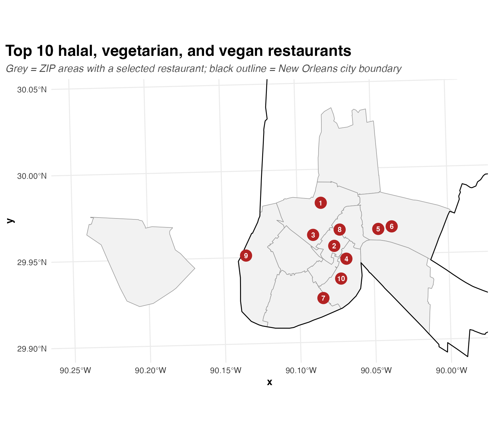
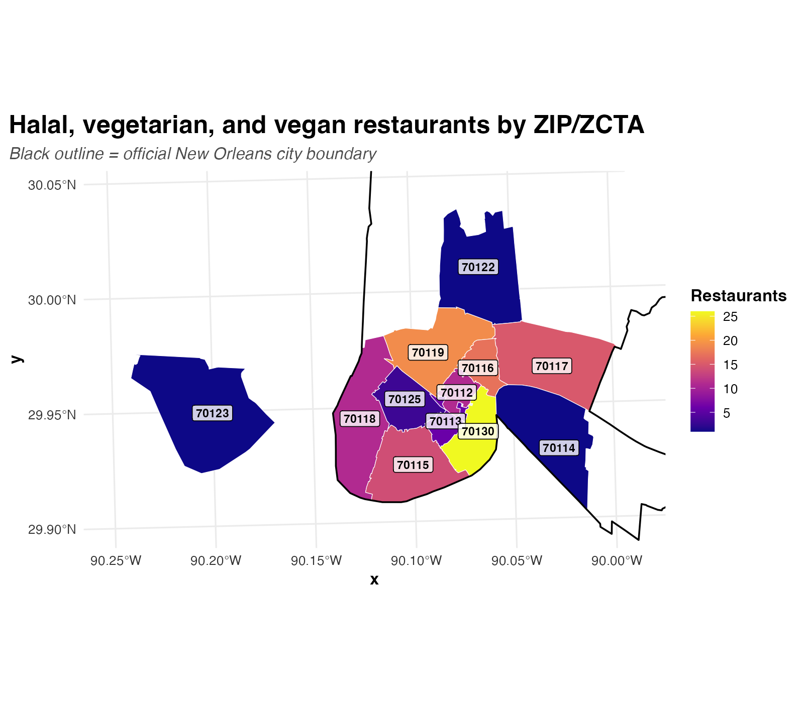
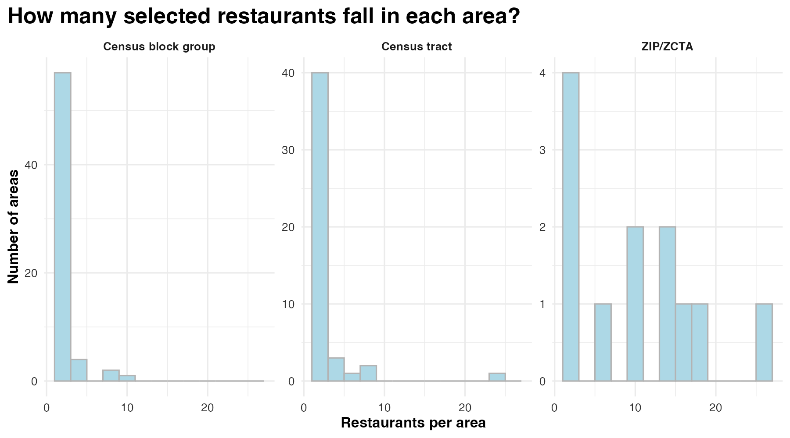
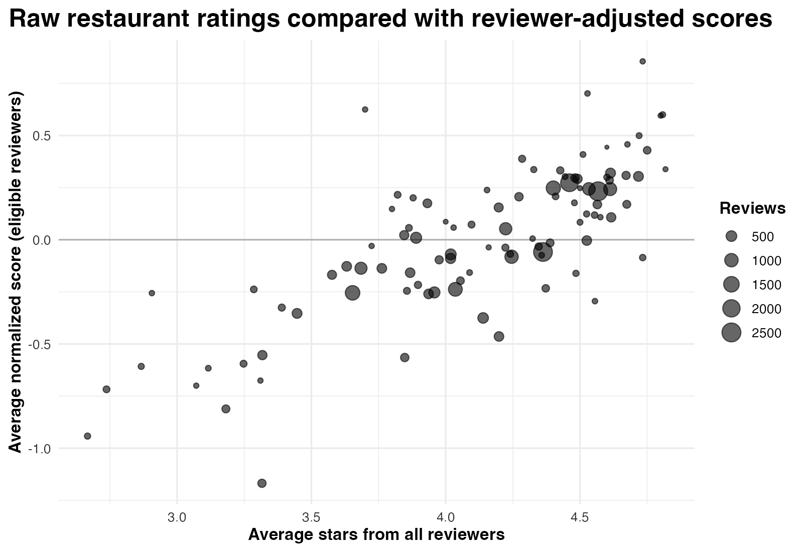

# Dietary-Restriction Restaurants in New Orleans

**Research question:** Where in New Orleans can someone who eats halal, vegetarian, or vegan food find the best restaurants, and which geographic area is most useful for finding them?

## Executive summary

Using all 476,421 Yelp reviews of New Orleans restaurants, I found 125 restaurants tagged halal, vegetarian, or vegan and compared three ways of dividing the city into areas; ZIP codes worked best. ZIP 70119 is the most dependable area for finding these restaurants (19 restaurants, the second-best reviewer-adjusted score, and two of my top 10), while ZIP 70130 offers the most choice (26 restaurants). Adjusting each rating for the reviewer's own habits changes the ranking a lot: the raw top of the list is led by places with very few reviews (Viva Las Vegan has 5), while my top 10 is led by The Fat Falafel, Ms. Beasley's, and Addis Nola. The main caveat is that the adjusted scores use only reviewers with at least five reviews (9.6% of reviews), and several top-10 restaurants rest on only 5 to 10 such reviews.

**[View the complete rendered report](https://adithiv3.github.io/yelp-new-orleans-project/yelp_new_orleans_project.html)**

## Main findings

1. **ZIP codes were the most useful geography.** The 125 selected restaurants fall into 12 ZIP areas with a median of 11 restaurants each, with none unmatched; Census tracts (median 2 per area) and block groups (median 1) were too sparse for stable comparisons.
2. **The area with the most choice is not the area with the best ratings.** ZIP 70130 has the most restaurants (26) and ZIP 70112 has the highest raw average (4.41). After adjusting for reviewer habits, ZIP 70113 leads, and ZIP 70119 is the most dependable choice (19 restaurants, second-best adjusted score).
3. **Adjusting for reviewer habits changes the story.** Green To Go ranks 81st by raw stars but 4th after adjustment, while Catalino's falls from 5th to 63rd.

## Top 10 restaurants

| Rank | Restaurant | ZIP | Reviews (all) | Reviews (eligible) | Avg stars (all) | Avg normalized score | Raw rank in pool |
|---:|:---|:---|---:|---:|---:|---:|---:|
| 1 | The Fat Falafel | ZIP 70119 | 30 | 9 | 4.73 | 0.86 | 5 |
| 2 | Ms. Beasley's | ZIP 70112 | 36 | 7 | 4.53 | 0.70 | 24 |
| 3 | Addis Nola | ZIP 70119 | 156 | 28 | 4.75 | 0.43 | 4 |
| 4 | Green To Go | ZIP 70130 | 30 | 6 | 3.70 | 0.62 | 81 |
| 5 | Capulet | ZIP 70117 | 50 | 10 | 4.72 | 0.50 | 7 |
| 6 | Botanicals Nola | ZIP 70117 | 25 | 6 | 4.80 | 0.60 | 3 |
| 7 | LemonShark Poke | ZIP 70115 | 116 | 23 | 4.28 | 0.39 | 46 |
| 8 | I-tal Garden | ZIP 70116 | 34 | 10 | 4.68 | 0.46 | 9 |
| 9 | Breads on Oak Cafe & Bakery | ZIP 70118 | 401 | 83 | 4.61 | 0.32 | 13 |
| 10 | Tea Witch Cafe | ZIP 70130 | 52 | 5 | 4.81 | 0.60 | 2 |

Ranked by reviewer-adjusted score after shrinkage, so the order is not simply by the "Avg normalized score" column.



## Choosing a geographic area

I compared ZIP Code Tabulation Areas, Census tracts, and Census block groups for the selected restaurants and chose ZIP/ZCTA.

| Geographic system | Areas with a selected restaurant | Restaurants assigned | Unmatched | Smallest area | Median area | Largest area | Areas with 5+ |
|:---|---:|---:|---:|---:|---:|---:|---:|
| ZIP/ZCTA | 12 | 125 | 0 | 1 | 11 | 26 | 8 |
| Census tract | 47 | 124 | 1 | 1 | 2 | 24 | 4 |
| Census block group | 64 | 124 | 1 | 1 | 1 | 10 | 4 |





## Raw ratings versus reviewer-adjusted scores



## Methods in brief

* **Data:** the Yelp Open Dataset (business and review files). The 5 GB review file was read in chunks of 100,000 reviews and filtered to New Orleans restaurants, leaving 2,259 restaurants and 476,421 reviews. The category group (halal, vegetarian, vegan) contains 125 restaurants.
* **Spatial joins:** restaurants were converted to `sf` points and joined to Census ZIP/ZCTA, tract, and block-group polygons, and checked against the official city boundary from `tigris`.
* **Reviewer-adjusted score:** each rating minus that reviewer's mean rating within the selected restaurants, using reviewers with enough activity (threshold justified in the report). Restaurants are ranked by a score shrunk toward zero so that small samples cannot dominate.

## Limitations

Yelp categories are labels, not certification of dietary practices. Ratings reflect who chooses to review. Some areas have few restaurants, and ZIP/ZCTAs are not neighborhoods. See the report for details.

## Repository contents

```text
README.md                         this page
yelp_new_orleans_project.qmd      Quarto source for the full report
docs/                             rendered HTML report (for GitHub Pages)
R/01_import_and_filter.R          import of the large JSON files and filter to New Orleans restaurants
data/new_orleans/                 filtered, compressed .rds files (raw JSON is not committed)
figures/                          saved maps, plots, and tables used in this README
ai-prompts.md                     AI prompts I used, with examples of re-prompting
```

## Data and how to reproduce

The raw Yelp JSON files are not committed to this repository (they are several GB).

1. Download the Yelp Open Dataset (JSON) from <https://business.yelp.com/data/resources/open-dataset/>.
2. Extract `yelp_academic_dataset_business.json` and `yelp_academic_dataset_review.json` into `data/raw/`.
3. Run `R/01_import_and_filter.R`. It filters to New Orleans restaurants and saves compressed `.rds` files in `data/new_orleans/`. The 78 MB `reviews_new_orleans_with_text.rds` is created but is not committed.
4. Render the report: `quarto render yelp_new_orleans_project.qmd --output-dir docs`.

The report only needs the `.rds` files in `data/new_orleans/` (it reads `business_new_orleans.rds` and `reviews_new_orleans.rds`), so the raw files can be deleted after step 3.

R packages: `tidyverse`, `jsonlite`, `sf`, `tigris`, `scales`, `viridis`, `lubridate`, `knitr`. Boundary files are downloaded by `tigris` the first time the report is rendered.

## Source code

* [Data import and filter code](R/01_import_and_filter.R)
* [Quarto source for the report](yelp_new_orleans_project.qmd)
* [AI prompts](ai-prompts.md)